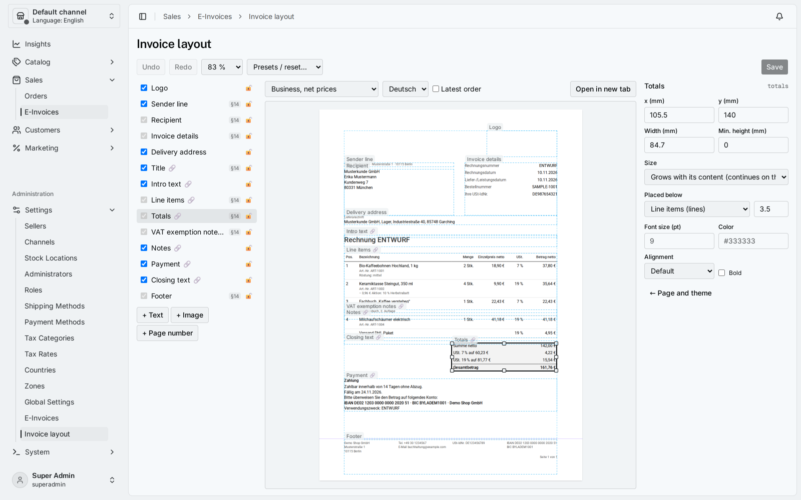
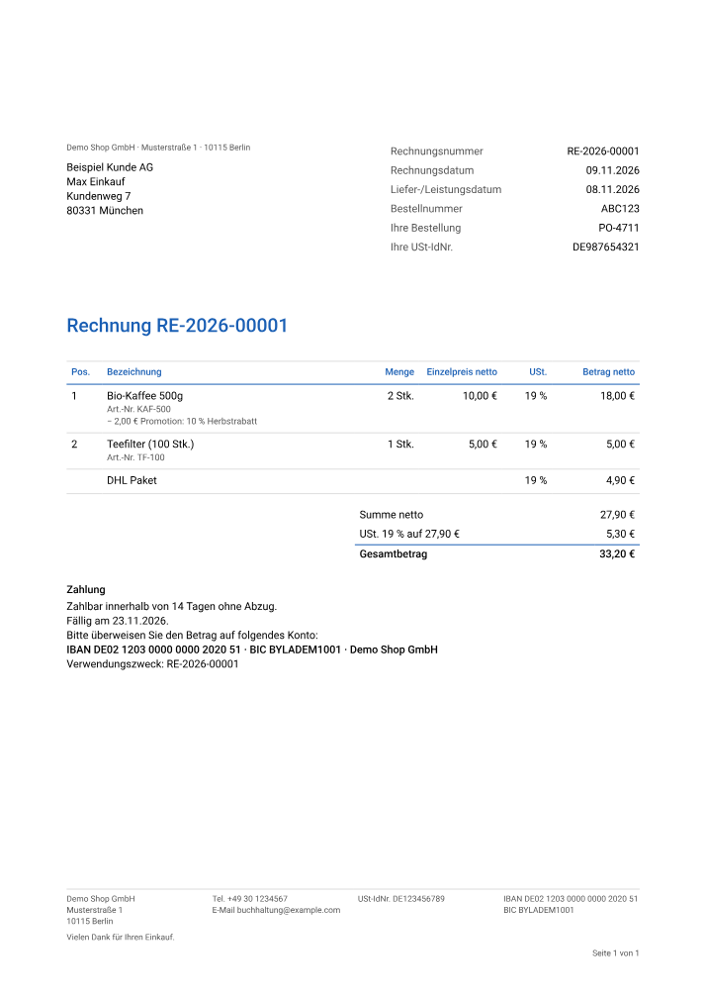
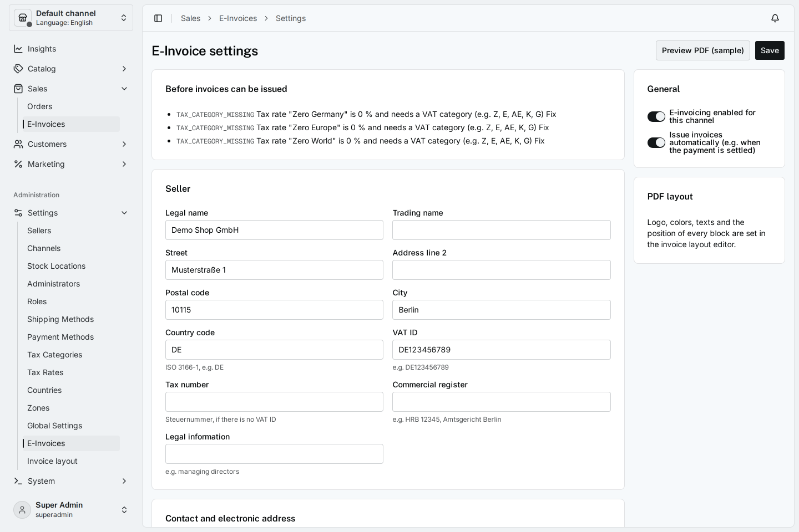

# Vendure E-Invoice Plugin

[](https://github.com/OpenRootz/vendure-plugin-e-invoice/actions/workflows/ci.yml)
[](https://www.npmjs.com/package/@openrootz/vendure-plugin-e-invoice)
[](LICENSE)
[](https://vendure.io)
[](#validated-output)

EN 16931 e-invoicing for [Vendure](https://vendure.io) v3. The plugin issues **ZUGFeRD / Factur-X** invoices
(PDF/A-3b with the CII XML embedded) and **XRechnung** (CII or UBL) for your orders, with gap-free numbering,
credit notes for refunds and cancellations, signed downloads for admins and customers, and a dashboard extension
with a visual invoice layout editor.



## Why

In Germany, businesses must be able to receive e-invoices since 2025; **issuing them becomes mandatory for B2B
from 2027** (turnover above €800k) and for everyone from 2028. Other EU countries follow with their own
deadlines. A PDF generated from an HTML template is no longer enough: the invoice needs a structured, validated
EN 16931 data set, and the numbering, retention and correction rules still apply.

This plugin does that inside Vendure, without a browser, a Java runtime or an external SaaS.

## Features

- **One invoice model, several formats**: ZUGFeRD (profile EN 16931) for every order; XRechnung CII when the
  buyer has a Leitweg-ID (German public authorities); UBL on request.
- **Validated output**: every scenario is checked with the official validators (KoSIT, Mustang, veraPDF) in CI;
  optional runtime validation against a KoSIT sidecar.
- **Gap-free numbers**: the number format is yours (`RE-2026-00001` by default), the counter is row-locked inside
  the issuing transaction. A failed check never uses a number; a failed render keeps it and documents it.
- **Immutable documents**: the invoice data is stored as a snapshot; files are only ever rendered from it.
  Corrections happen through credit notes (type 381).
- **Credit notes**: automatic for settled refunds (amount-only refunds are split across the VAT rates),
  cancellations and order modifications; manual credit notes per line, for shipping or a free amount.
- **Checks before issuing**: missing seller data, a 0 % rate without VAT category, reverse charge without buyer
  VAT ID or totals that do not match the order are explained in plain words, with a link to where they are fixed.
- **Visual layout editor**: drag and resize blocks on the real PDF, presets for DIN 5008 Form A/B, layout checks
  for the content §14 UStG requires. Or bring your own [pdfmake](https://pdfmake.github.io/docs/) template.
- **Signed downloads**: time-limited links for admins, customers and guests, ZIP export, SHA-256 checked files.
- **Storage**: database (default) or a local directory; anything else (object storage, WebDAV, a DMS) through a
  small custom strategy. No cloud vendor SDK is bundled.
- **No browser, no Java at runtime**: PDFs are rendered with pdfmake (pure JavaScript).
- **Extensible**: strategies for numbering, seller and buyer data, formats, PDF, storage and validation, plus
  mapping hooks for the invoice model.

| ZUGFeRD PDF (sample)                                        | Settings and setup status                                        |
| ----------------------------------------------------------- | ---------------------------------------------------------------- |
|  |  |

## Contents

- [Requirements](#requirements)
- [Installation](#installation)
- [Setup checklist](#setup-checklist)
- [How it works](#how-it-works)
- [Options](#options)
- [Customisation](#customisation)
- [APIs and downloads](#apis-and-downloads)
- [Dashboard](#dashboard)
- [Runtime validation](#runtime-validation)
- [Storage](#storage)
- [Validated output](#validated-output)
- [Legal notes](#legal-notes)
- [Limitations](#limitations)
- [Roadmap](#roadmap)
- [Development](#development)
- [Contributing](#contributing)

## Requirements

| Component | Version                                                                                             |
| --------- | --------------------------------------------------------------------------------------------------- |
| Vendure   | `^3.8` (developed against 3.8.1)                                                                    |
| Node.js   | ≥ 22 (CI: 22 and 24)                                                                                |
| Database  | PostgreSQL and SQLite/sql.js are tested in CI; MySQL/MariaDB get `LONGBLOB`/`LONGTEXT` column types |
| Dashboard | the React dashboard (`@vendure/dashboard`) for the UI extension; the APIs work without it           |

## Installation

```bash
pnpm add @openrootz/vendure-plugin-e-invoice
# or: npm install @openrootz/vendure-plugin-e-invoice
```

```ts
// vendure-config.ts
import { EInvoicePlugin } from '@openrootz/vendure-plugin-e-invoice';

export const config: VendureConfig = {
  // ...
  plugins: [
    EInvoicePlugin.init({
      // Signs download links. At least 32 characters; keep it secret and stable.
      secret: process.env.E_INVOICE_SECRET!,
    }),
  ],
};
```

The plugin adds entities and custom fields, so generate and run a migration
([Vendure migrations](https://docs.vendure.io/guides/developer-guide/migrations/)):

```bash
npx vendure migrate
```

Tables: `e_invoice`, `e_invoice_file`, `e_invoice_sequence`, `e_invoice_channel_settings`, `e_invoice_blob`. The
`e_invoice_` prefix lets the plugin run next to other invoice plugins.

## Setup checklist

E-invoicing is **off** per channel until you enable it.

1. **Seller data** (Settings → E-Invoices in the dashboard, or `updateEInvoiceChannelSettings`): legal name,
   address, VAT ID or tax number, contact (name, phone, email) and an electronic address where buyers send e-invoices
   (e.g. `EM` + `rechnung@example.com`). Add a bank account if invoices can have an amount due.
2. **Tax rates**: every rate of 0 % needs a VAT category in its `E-Invoice` tab (`Z` zero rated, `E` exempt,
   `AE` reverse charge, `K` intra-community supply, `G` export, `O` not subject to VAT). `E`, `AE`, `K`, `G`, `O`
   also need an exemption reason or VATEX code. Rates above 0 % default to `S` (standard).
3. **Payment methods** (optional): the `E-Invoice` tab takes the UNTDID 4461 payment means code, e.g. `48`
   (card), `58` (SEPA credit transfer), `59` (SEPA direct debit), `68` (online payment service). Default: `ZZZ`
   with the method name.
4. **Enable** e-invoicing for the channel. `eInvoiceSetupStatus` (shown on the settings page) lists anything that
   is still missing. `eInvoiceSetupWarnings` (also shown there) lists seller data that looks wrong: a country code
   that is not ISO 3166-1, a VAT ID that does not match the format of its EU member state, an IBAN with a wrong
   length or check digits, a malformed BIC or email address. Warnings do not block invoices, but the values are
   printed on every invoice. Saving the settings upper-cases country code, VAT ID, IBAN and BIC and removes spaces.
5. Optionally design the PDF in the layout editor (Settings → Invoice layout): logo, colors, texts, block positions.

## How it works

```
Order reaches PaymentSettled ─▶ reconcile ─▶ checks ──fail──▶ BLOCKED (no number; fix and retry)
                                               │
                                               └─pass─▶ number reserved, snapshot stored ─▶ PENDING
                                                         render job (worker) ─▶ ISSUED  (or FAILED → retry / void)
```

- **Triggers**: an order entering one of `issueOnStates` (default `PaymentSettled`) gets an invoice, if the
  channel has `autoIssue` on. Admins can always create one manually.
- **Checks** run before a number is reserved and explain problems in plain words (missing seller data, a 0 % rate
  without VAT category, reverse charge without buyer VAT ID, totals that do not match the order, …).
- **Rendering** happens in the job queue from the stored snapshot, never from the (possibly changed) order.
- **Statuses**: `BLOCKED` (checks failed, no number), `PENDING` (rendering), `ISSUED` (final), `FAILED` (rendering
  or validation failed; retry re-renders the snapshot), `VOID` (a failed document that can never be rendered; the
  number stays used and the reason documents the gap).
- **Credit notes** reference the corrected invoice (BT-25) and always use the invoice's snapshot prices:
  - settled refund → credit note for the refunded amount, split proportionally across the VAT rates
    (one credit line per rate);
  - order cancelled → the remaining amount is credited in full;
  - order modified after invoicing → full credit note plus a new invoice for the current order;
  - manual: per line and quantity, shipping, a free amount, or a full reversal.

  The credited quantities and amounts can never exceed the invoice.

### Buyer data

The plugin registers optional custom fields (tab `E-Invoice`):

| Entity          | Fields                                                                                                                                  |
| --------------- | --------------------------------------------------------------------------------------------------------------------------------------- |
| `Order`         | `eInvoiceVatId` (BT-48), `eInvoiceBuyerReference` (BT-10), `eInvoiceLeitwegId`, `eInvoicePurchaseOrder` (BT-13), `eInvoiceNote` (BT-22) |
| `Customer`      | `eInvoiceVatId`, `eInvoiceBuyerReference`, `eInvoiceLeitwegId` (used when the order field is empty)                                     |
| `TaxRate`       | `eInvoiceCategoryCode`, `eInvoiceExemptionReason`, `eInvoiceExemptionReasonCode`                                                        |
| `PaymentMethod` | `eInvoicePaymentMeansCode`                                                                                                              |

The order and customer fields are readable and writable in the Shop API by default, so B2B customers can enter
their VAT ID or Leitweg-ID at checkout (`setOrderCustomFields`). Set `exposeBuyerFieldsInShop: false` to keep them
admin-only.

Defaults: name and address from the billing address (company first, fallback shipping address), email as electronic
address, buyer reference = Leitweg-ID, else the buyer reference field, else the order code. With a Leitweg-ID an
XRechnung (CII) is issued in addition to the ZUGFeRD PDF.

## Options

```ts
EInvoicePlugin.init({
  secret: process.env.E_INVOICE_SECRET!, // required
  issueOnStates: ['PaymentSettled'], // automatic invoices
  autoCreditNotes: true, // refunds, cancellations, modifications
  taxCalculation: 'vendure', // or 'en16931', see below
  roundingFallbackThreshold: 50, // minor units
  timeZone: 'Europe/Berlin', // issue and due dates; default: server time zone
  exposeBuyerFieldsInShop: true,
  downloadLinks: { guestTtl: '7d', ownerTtl: '1h', adminTtl: '15m', baseUrl: 'https://shop.example.com' },
  validation: { validator: new KositHttpValidator({ url: 'http://kosit:8080/' }), mode: 'report' },
  storage: new DatabaseInvoiceStorageStrategy(),
  numberStrategy: new DefaultInvoiceNumberStrategy({ invoicePrefix: 'RE', creditNotePrefix: 'GS' }),
  sellerStrategy: new ChannelSettingsSellerStrategy(),
  buyerStrategy: new DefaultBuyerDataStrategy(),
  formatStrategy: new DefaultInvoiceFormatStrategy(),
  pdfStrategy: new DefaultTemplatePdfStrategy(),
  pdf: { fonts: undefined, translations: { de: { invoice: 'Rechnung' } } },
  mapping: {/* hooks, see below */},
});
```

### VAT calculation

Vendure computes tax per order line; EN 16931 computes it per VAT rate on the sum. The difference is at most a few
cents.

- `'vendure'` (default): the VAT per rate is the sum of Vendure's line taxes. The invoice matches the order and the
  payment exactly. This is within the tolerance of the EN 16931 rules (±1 currency unit per rate). If the
  difference for a rate reaches `roundingFallbackThreshold`, that invoice falls back to `'en16931'`.
- `'en16931'`: tax on the sum per rate; the difference to the order total is shown as rounding amount (BT-114).

Please confirm the approach with your tax adviser.

## Customisation

### Invoice numbers

```ts
numberStrategy: new DefaultInvoiceNumberStrategy({ invoicePrefix: 'INV', creditNotePrefix: 'CN', padding: 6, yearly: false }),
```

Or implement `InvoiceNumberStrategy`: `sequenceKey()` decides which counter a document draws from (e.g. one per
channel, type and year), `format()` renders the number from the counter value. The plugin owns the counter and
guarantees it is gap-free; the number must be unique per channel.

### PDF layout

Level 1, no code: the **layout editor** in the dashboard (Settings → Invoice layout). The layout is a document of
blocks (logo, sender line, recipient, details, title, texts, line table, totals, payment, footer, page number, free
texts and images), each with a free frame on the page:

- `overflow: 'grow'` blocks take the height their content needs and continue on the next page; `fixed` blocks
  keep their frame. An `anchor` places a block below another one, so it moves with content of unknown length
  (the default layout anchors totals → line table → …).
- Saving runs the layout checks against a worst-case sample invoice: every field §14 UStG requires must be printed
  by a visible block, fixed blocks must not clip their content, frames must be on the page, two growing blocks
  must not stand side by side. Overlaps, the 5 mm border, the DIN 5008 window, small fonts and low contrast are
  warnings.
- When real data still does not fit into a fixed block, its font shrinks down to 6 pt and the content is then
  printed beyond the frame; it is never cut off, and a `LAYOUT_OVERFLOW` warning is added to the invoice's
  validation summary.

Labels can be overridden per language with `pdf.translations` (German and English are built in; the language
follows the channel default or `mapping.language`). Layouts saved before the editor (accent color and texts) are
converted when read.

Level 2: your own layout as a [pdfmake](https://pdfmake.github.io/docs/) document definition. `input.layout` is
the channel's layout document; `compileLayout`, `layoutTemplate`, `defaultTemplate`, `blockRenderers` and
`checkLayout` are exported, so you can start from the shop's layout and change details:

```ts
import { defaultTemplate, InvoicePdfStrategy, PdfTemplateInput } from '@openrootz/vendure-plugin-e-invoice';

class MyPdfStrategy implements InvoicePdfStrategy {
  buildDocDefinition(ctx: RequestContext, input: PdfTemplateInput) {
    const doc = defaultTemplate(input); // or build your own from input.model and input.labels
    return { ...doc, watermark: { text: 'COPY', opacity: 0.1 } };
  }
}
```

The plugin always enforces PDF/A-3b, embedded fonts, the attached XML and the Factur-X metadata, so a template
cannot produce a non-compliant e-invoice. Templates cannot load URLs or files; images must be data URLs.
Custom fonts: `pdf.fonts` with TTF paths (`{ MyFont: { normal, bold, italics, bolditalics } }`); the default is
Roboto (Latin, Greek, Cyrillic). A layout can pick one of them as `theme.font`.

### Other strategies and hooks

| Option                     | Default                                          | Purpose                                                                   |
| -------------------------- | ------------------------------------------------ | ------------------------------------------------------------------------- |
| `sellerStrategy`           | `ChannelSettingsSellerStrategy`                  | seller data, bank account and payment terms                               |
| `buyerStrategy`            | `DefaultBuyerDataStrategy`                       | buyer, buyer reference, delivery address, notes                           |
| `formatStrategy`           | ZUGFeRD, + XRechnung CII with a Leitweg-ID       | which files a document gets (`zugferd`, `xrechnung-cii`, `xrechnung-ubl`) |
| `mapping.deliveryDate`     | issue date                                       | BT-72                                                                     |
| `mapping.taxCategory`      | TaxRate custom fields                            | VAT category per line, e.g. `AE` for EU B2B with VAT ID                   |
| `mapping.paymentMeans`     | PaymentMethod custom field                       | BG-16                                                                     |
| `mapping.unitCode`         | `H87` (piece)                                    | BT-130                                                                    |
| `mapping.language`         | channel default language                         | PDF language                                                              |
| `mapping.priceDisplay`     | net for business buyers, else gross              | line prices in the PDF                                                    |
| `mapping.creditAllocation` | proportional to the remaining gross per VAT rate | split of amount-only refunds                                              |
| `mapping.transformModel`   | —                                                | last-mile change of the invoice model before the checks                   |

## APIs and downloads

### Admin API

Permissions: `CreateEInvoice` (issue invoices and credit notes), `ReadEInvoice` (view and download), `UpdateEInvoice`
(retry, void, settings and layout). There is no `DeleteEInvoice`: issued documents are immutable and never deleted.
`ReadEInvoice` does not grant access to orders: `eInvoicePreview`, `eInvoiceLayoutPreview` with an `orderId` and the
`EInvoice.order` field also need `ReadOrder` (without it, `order` is `null`). Guest links work for days without a login,
so `createEInvoiceGuestLink` needs `CreateEInvoice`; links that expire after minutes (`downloadUrl`, ZIP) only need
`ReadEInvoice`.

`EInvoice.reason` tells why a document was created: `auto` (trigger), `manual` (issued or credited by an admin),
`refund`, `cancellation` (order cancelled), `modification` (order modified) and `reissue`
(`cancelAndReissueEInvoice`). `modification` and `reissue` mark a pair: the full credit note and the new invoice.

| Query / mutation                                            |                                                                                                                                                                 |
| ----------------------------------------------------------- | --------------------------------------------------------------------------------------------------------------------------------------------------------------- |
| `eInvoices(options)`                                        | list with filters and sorting (incl. `type`, `status`, `orderCode`)                                                                                             |
| `eInvoice(id)`, `Order.eInvoices`                           | documents incl. files, issues, credit notes, `remainingAmount`, `creditable`, `validation`                                                                      |
| `eInvoicePreview(orderId)`                                  | the PDF the order would get now, with a draft number; nothing is saved                                                                                          |
| `eInvoiceLayoutPreview(input)`                              | renders an unsaved layout (and unsaved seller data) with sample data or an order; returns the PDF, page count, where every block ended up and the layout issues |
| `eInvoiceDefaultLayout(preset)`                             | a layout document to start from: default, DIN 5008 Form A/B, minimal                                                                                            |
| `eInvoiceSetupStatus`                                       | what is missing in the channel                                                                                                                                  |
| `eInvoiceSetupWarnings`                                     | seller data that looks wrong (country code, VAT ID, IBAN, BIC, email); does not block issuing                                                                   |
| `eInvoiceChannelSettings` / `updateEInvoiceChannelSettings` | seller, payment terms, layout (rejected if the layout checks report errors)                                                                                     |
| `createEInvoice(orderId)`                                   | manual invoice; returns a BLOCKED invoice with `issues` if data is missing                                                                                      |
| `retryEInvoice(id)`                                         | BLOCKED: map the order again; FAILED: render again                                                                                                              |
| `voidEInvoice(id, reason)`                                  | FAILED → VOID                                                                                                                                                   |
| `createEInvoiceCreditNote(input)`                           | lines, shipping, amount or full reversal                                                                                                                        |
| `cancelAndReissueEInvoice(invoiceId)`                       | full credit note + new invoice for the current order                                                                                                            |
| `createEInvoiceGuestLink(invoiceId, format)`                | download link valid for `guestTtl` (7 days); needs `CreateEInvoice`                                                                                             |
| `createEInvoiceZipLink(ids)`                                | ZIP of several issued documents                                                                                                                                 |

### Shop API

```graphql
query {
  activeCustomer {
    orders {
      items {
        code
        eInvoices {
          number
          type
          issueDate
          totalWithTax
          files {
            format
            fileName
            downloadUrl
          }
        }
      }
    }
  }
}
```

Only issued documents are visible, and only through Vendure's own ownership checks (`activeCustomer`,
`orderByCode`). Note that Vendure's default `orderByCode` access strategy lets anyone with the order code read a
guest order for 2 hours after it was placed.

### Download links

Every download goes through `GET /e-invoice/download/:id?f=<format>&exp=…&sig=…` (or `/e-invoice/zip?ids=…`). The
GraphQL API checks permissions or ownership and returns a link signed with HMAC-SHA256 over the document, format,
expiry and channel token; the route only verifies the signature, so plain `<a href>` links work. Expired links
answer `410`, invalid ones `403`. Files are checked against their SHA-256 before they are sent.

Set `downloadLinks.baseUrl` in production. Without it, links are built from the `Host` header of the request,
which a client can choose freely unless your proxy overwrites it; the plugin logs a warning the first time this
happens. It is also required behind a proxy, when creating links outside a request (e.g. in a job) and for guest
links created outside the Admin API (e.g. in an email handler that runs during a Shop API request): these go to
someone else and must not point to a host the client chose.

The download route is public (the signature is the authorization). It answers with `Cache-Control: private,
no-store`, `Content-Disposition: attachment`, `X-Content-Type-Options: nosniff`, a sandboxing
`Content-Security-Policy` and `Referrer-Policy: no-referrer`.

To put a link into your order confirmation email, listen for `EInvoiceIssuedEvent` and use `DownloadLinkService`:

```ts
const url = injector.get(DownloadLinkService).fileLink(event.ctx, event.invoice, 'zugferd', 'guest');
```

Rotating `secret` or the channel token invalidates all links; a single link cannot be revoked. A link is a bearer
token in its query string: anyone who gets it can download until it expires, and it can end up in proxy access
logs and browser histories. Keep `guestTtl` as short as your emails allow and keep query strings out of shared logs.

### Events

`EInvoiceIssuedEvent` (files are ready), `EInvoiceBlockedEvent` (checks failed, with `issues`),
`EInvoiceFailedEvent` (rendering or validation failed).

## Dashboard

The plugin ships an extension for the React dashboard (`@vendure/dashboard`), compiled by your dashboard build:

- **Order detail page**: invoices and credit notes with status, downloads and actions (create, credit note,
  cancel & reissue, retry, void, copy guest link, PDF preview). Blocked invoices list their problems with links to
  where they are fixed.
- **Sales → E-Invoices**: list with filters and ZIP download of the selection.
- **Settings → E-Invoices**: seller data, bank account, payment terms, setup status, PDF preview with sample data.
- **Settings → Invoice layout**: the visual layout editor. The real PDF (sample invoices or the latest order) is
  rendered by the server and shown with pdf.js; drag and resize blocks on the page (snapping to a 1 mm grid, the
  margins and other blocks; Shift = free; arrow keys move by 0.5 mm, with Shift by 5 mm), show or hide them, anchor
  them below growing blocks, edit texts, fonts and colors, add free texts, images and page numbers, start from a
  preset (DIN 5008 Form A/B, minimal), undo and redo. Blocks that carry content §14 UStG requires are marked and
  cannot be hidden when they are its last carrier; saving is disabled while the layout checks report errors.
- The custom fields appear in the `E-Invoice` tab of orders, customers, tax rates and payment methods.

No extra configuration is needed: `vendureDashboardPlugin` finds the extension through the plugin metadata.

There is no extension for the legacy Angular Admin UI. Shops that still use it can work with the Admin API
directly; invoices are issued automatically either way.

## Runtime validation

Validation belongs in CI (this repository validates every scenario with KoSIT, Mustang and veraPDF). For extra
safety in production, run the [KoSIT validator](https://github.com/itplr-kosit/validator) with the XRechnung
configuration as a sidecar in daemon mode and enable:

```ts
validation: { validator: new KositHttpValidator({ url: 'http://kosit:8080/' }), mode: 'report' },
```

- `report`: every file is validated (the ZUGFeRD PDF through its embedded XML), the result is stored and shown
  (`EInvoice.validation`), the document is issued anyway.
- `enforce`: a rejected document, or one that could not be validated, is `FAILED` with the messages; retry or void it.

`test/validate/kosit-daemon.sh` shows how to start the daemon with Docker. Custom validators implement
`InvoiceValidator`.

## Storage

| Strategy                                   |                                                                                                                    |
| ------------------------------------------ | ------------------------------------------------------------------------------------------------------------------ |
| `DatabaseInvoiceStorageStrategy` (default) | files in the `e_invoice_blob` table: no setup, covered by your database backup, written in the same transaction    |
| `LocalFileInvoiceStorageStrategy({ dir })` | `<dir>/<channel>/<year>/<file>`; server and worker must share the directory; never use a publicly served directory |

Files are never overwritten or deleted by the plugin. Invoices must not be stored with the `AssetStorageStrategy`,
because assets are public.

### Custom storage

To keep the files somewhere else, for example in an object storage of your choice, on a WebDAV server or in a
document management system, implement `InvoiceStorageStrategy`. It has two methods: `save` stores a file and returns
an ID of your choice, `read` returns the file for that ID. A custom storage must follow the same rules as the built-in
ones:

- **Never overwrite or delete** a file. Issued invoices are immutable and must be kept for at least 8 years.
- **Expect a second save of the same key.** When an issuing transaction is rolled back, its file may already be
  stored. Reuse it if the content is identical, otherwise store the new file under a different key.
- **Keep the files private.** Downloads always go through the plugin's signed links, never directly to the storage.

```ts
import { RequestContext } from '@vendure/core';
import { InvoiceStorageStrategy, safeKey, StoredFileInput } from '@openrootz/vendure-plugin-e-invoice';
import { createHash } from 'crypto';

/** The client of your storage. */
interface FileStore {
  get(key: string): Promise<Buffer | undefined>;
  /** Writes the file unless the key exists; returns false if it existed. */
  putIfAbsent(key: string, data: Buffer, mimeType: string): Promise<boolean>;
}

export class MyInvoiceStorageStrategy implements InvoiceStorageStrategy {
  constructor(private store: FileStore) {}

  async save(ctx: RequestContext, file: StoredFileInput): Promise<string> {
    const key = safeKey(file.key); // e.g. default/2026/RE-2026-00001.pdf
    if (await this.store.putIfAbsent(key, file.data, file.mimeType)) return key;
    if ((await this.store.get(key))?.equals(file.data)) return key; // left over from a rolled-back attempt
    const variant = `${key}.${createHash('sha256').update(file.data).digest('hex').slice(0, 12)}`;
    await this.store.putIfAbsent(variant, file.data, file.mimeType);
    return variant;
  }

  async read(ctx: RequestContext, storageId: string): Promise<Buffer> {
    const data = await this.store.get(storageId);
    if (!data) throw new Error(`Invoice file ${storageId} not found`);
    return data;
  }
}
```

```ts
EInvoicePlugin.init({ secret, storage: new MyInvoiceStorageStrategy(myStore) });
```

Like every Vendure strategy, it can implement `init(injector)` and `destroy()` to open and close connections.

## Validated output

The CI pipeline generates invoices for a set of scenarios (B2B net and B2C gross prices, mixed VAT rates, reverse
charge, intra-community supply, export, a seller with a tax number only, partial and goodwill credit notes, rounding
cases, custom layouts) and from real orders in end-to-end tests (Leitweg-ID, refunds, cancellations, order
modifications), then validates every file with:

| Validator                                                                                    | Checks                                             |
| -------------------------------------------------------------------------------------------- | -------------------------------------------------- |
| [KoSIT validator](https://github.com/itplr-kosit/validator) with the XRechnung configuration | EN 16931 and XRechnung rules for CII and UBL       |
| [Mustang](https://www.mustangproject.org/)                                                   | ZUGFeRD / Factur-X: PDF, embedded XML and metadata |
| [veraPDF](https://verapdf.org/)                                                              | PDF/A-3b                                           |

You can run the same checks locally with `pnpm validate` (Docker required).

## Legal notes

This plugin helps you create compliant e-invoices; it is not tax or legal advice.

- Have your tax adviser confirm your setup, in particular the VAT categories of your tax rates, the VAT
  calculation mode and your invoice texts.
- **Retention**: invoices must be kept for at least 8 years (§ 147 AO). The plugin never deletes documents; your
  storage and backups must keep them as well.
- **GDPR**: the invoice snapshot contains personal data (name, address, email). Deleting a customer in Vendure does
  not delete their invoices, because the retention obligation takes precedence. Mention this in your privacy policy.
- Each file's SHA-256 is stored and checked on download, which makes changes detectable. The plugin does not claim
  GoBD certification; your overall process (archiving, access control, procedure documentation) determines that.

## Limitations

- One seller per channel (no split invoices for multi-vendor orders yet).
- Downloads only: sending invoices by email or via Peppol is not included yet.
- Outgoing invoices only; incoming e-invoices are not parsed.
- A goodwill refund that happens before an invoice is cancelled and reissued is not reflected in the new invoice.
- The dashboard extension targets the React dashboard; there is none for the Angular Admin UI.
- Vendure versions below 3.8 are not tested.

## Roadmap

Ideas for future versions, roughly in this order; feedback on what matters to you is welcome in the
[issues](https://github.com/OpenRootz/vendure-plugin-e-invoice/issues):

- Email delivery (invoice attached via the `EmailPlugin`) and new download links for expired guest links
- Custom block types for the layout editor
- Accounting export hook
- Peppol sending
- Multi-vendor orders: one invoice per seller

## Development

Requirements: Node ≥ 22, pnpm 11, Docker (Postgres for the dev server, validators).

```bash
pnpm install
pnpm test                   # unit + e2e (sql.js)
TEST_DB=postgres pnpm test  # e2e against Postgres (pnpm db:up first)
pnpm typecheck              # plugin and dashboard extension
pnpm lint                   # ESLint (pnpm lint:fix to fix what can be fixed)
pnpm format                 # Prettier (pnpm format:check in CI)
pnpm dashboard:build        # dashboard incl. the extension → test/__output__/dashboard
pnpm db:up && pnpm dev      # dev server: German shop in EUR on http://localhost:3050 (/dashboard, superadmin / superadmin)
pnpm validate [dir]         # KoSIT (XRechnung/EN 16931), Mustang (ZUGFeRD), veraPDF (PDF/A-3b)
pnpm validate test/golden   # validate the XML of all test scenarios
UPDATE_GOLDEN=1 pnpm test   # regenerate golden files after an intended output change
pnpm validate test/__output__/pdf # validate the ZUGFeRD PDFs of all scenarios (written by pnpm test)
pnpm validate test/__output__/e2e # validate the invoices generated from e2e orders
```

`TEST_DB=sqljs pnpm dev` starts the dev server without Docker. The sql.js e2e tests cache their seeded database in
`test/__data__/`. Delete that folder after changing entities, custom fields or test fixtures.

CI runs lint, formatting and `pnpm audit --prod` next to the tests; CodeQL scans the code and the workflows, and
Dependabot proposes dependency and GitHub Actions updates weekly.

## Contributing

Bug reports, questions and ideas are welcome as [issues](https://github.com/OpenRootz/vendure-plugin-e-invoice/issues).
Please read [CONTRIBUTING.md](CONTRIBUTING.md) first, and report security issues privately as described in
[SECURITY.md](SECURITY.md). This project follows a [code of conduct](CODE_OF_CONDUCT.md).

CI runs lint, formatting and `pnpm audit --prod` next to the tests; CodeQL scans the code and the workflows, and
Dependabot proposes dependency and GitHub Actions updates weekly.

## License

[MIT](LICENSE) © openrootz
